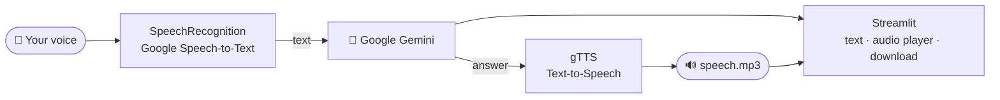

<div align="center">

# 🎙️ VoxGemini

### A voice-in, voice-out AI assistant: speak a question, hear Gemini's answer

*Click, ask out loud, and get the answer as text and as an MP3 you can play or download.*

<br/>


</div>

---

## 💡 What it does

VoxGemini connects three Google services into a single voice loop:



1. **Listen.** `SpeechRecognition` records from the microphone and transcribes with Google's recogniser.
2. **Think.** The text goes to **Google Gemini** through `google-generativeai`.
3. **Speak.** `gTTS` turns the answer into `speech.mp3`.
4. **Show.** Streamlit displays the answer text, an inline audio player and a **Download Speech** button.

Google STT and gTTS both support dozens of languages. To switch the spoken language, change the `language=` / `lang=` arguments in `src/helper.py`.

---

## 🚀 Quickstart

```bash
git clone https://github.com/nishantrv/MultiLingual-AI-Assitant.git
cd MultiLingual-AI-Assitant
conda create -n voxgemini python=3.10 -y && conda activate voxgemini
pip install -r requirements.txt
echo 'GOOGLE_API_KEY="your-key"' > .env
streamlit run app.py          # → http://localhost:8501
```

> **Linux:** PyAudio needs PortAudio first: `sudo apt install portaudio19-dev && pip install PyAudio`.

---

## ☁️ Deploy on AWS EC2

1. Launch an Ubuntu EC2 instance and open inbound port **8501** in its security group.
2. On the instance:

```bash
sudo apt update && sudo apt upgrade -y
sudo apt install -y git python3-pip portaudio19-dev
git clone https://github.com/nishantrv/MultiLingual-AI-Assitant.git && cd MultiLingual-AI-Assitant
pip3 install -r requirements.txt
echo 'GOOGLE_API_KEY="your-key"' > .env
nohup python3 -m streamlit run app.py &      # keeps running after you log out
```

3. Browse to `http://<EC2-public-IP>:8501`.

---

## 🗂️ Layout

```
app.py            Streamlit UI
src/helper.py     voice_input() · llm_model_object() · text_to_speech()
template.py       Project scaffolding script
research/         Experiments notebook
```

---

## 🧰 Tech stack

**Google Gemini** (`google-generativeai`) · **SpeechRecognition** · **PyAudio** · **gTTS** · **Streamlit** · **python-dotenv** · **AWS EC2**

---

<div align="center">

Built by **[Nishant](https://github.com/nishantrv)**. If this was useful, a ⭐ is appreciated.

</div>
